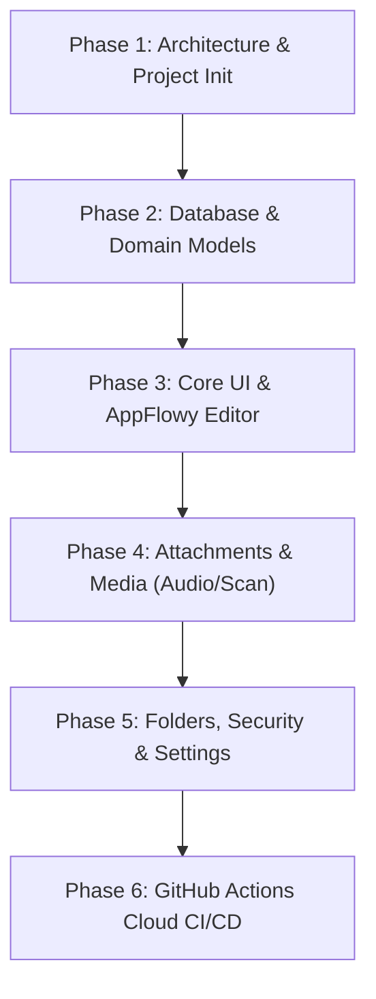

# 05. Clean-Room Rebuild Roadmap

> **Target Project:** Inotes App Clone  
> **Framework:** Flutter (Channel Stable)  
> **Build & CI Strategy:** 100% Cloud-Offloaded (GitHub Actions)  
> **Date:** 2026-11-01  

---

## 1. Execution Phases

### Phase 1: Architecture & Project Init
- Initialize Flutter project with package name matching user requirements.
- Wire extracted assets ([`assets/`](file:///D:/0/dusrel/notes/assets)) into `pubspec.yaml`.
- Integrate `easy_localization` with the 21 extracted translation dictionaries.
- Configure `flex_color_scheme` with light, dark, and OLED black palettes.

### Phase 2: Database & Domain Models
- Setup `objectbox` schemas for `Note`, `Folder`, `Attachment`, and `Tag`.
- Implement `NotesRepository` and `FoldersRepository` with full CRUD, search, and filter queries.
- Author unit tests for repository methods.

### Phase 3: Core UI & AppFlowy Editor
- **Notes Feed Screen:** Staggered grid / list view, pinned notes carousel, search bar, folder selector.
- **Note Editor Screen:** Clean, distraction-free editing interface powered by `appflowy_editor` with floating formatting toolbar.
- **Note Actions:** Color picker, share note, export as PDF/TXT.

### Phase 4: Attachments & Media
- Voice note recording and embedded playback bar.
- Document camera scanner with page cropping.
- Image attachment viewer.

### Phase 5: Folders, Security & Settings
- Folder management dialogs (color, icon/emoji picker).
- Trash management (restore, purge).
- Biometric App Lock & note-level password protection via `local_auth`.
- Multi-language switcher (20+ locales).

### Phase 6: GitHub Actions Cloud CI/CD
- Author `.github/workflows/build_apk.yml`.
- Automate `flutter analyze`, `flutter test`, and `flutter build apk --debug`.
- Zero local machine build overhead.

