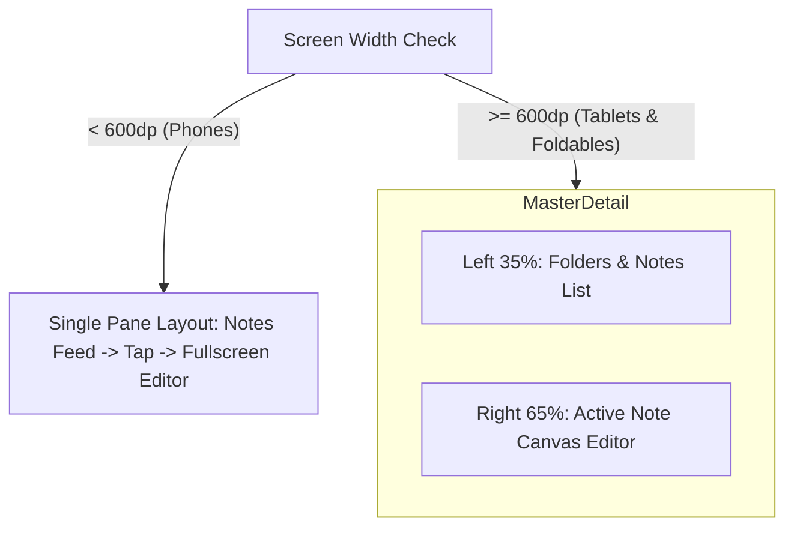

# 07. Deep UX, Animations, Smoothness & Responsive Architecture

> **Source Analysis:** Decompiled `PipelineCacheKeeper.java`, `MainActivity.java`, `libapp.so` Dart Snapshot  
> **Key Finding:** How the target app achieves instant, 120 FPS zero-jank performance and premium iOS-style polish on Android.  
> **Date:** 2026-11-01  

---

## 1. The Core Secret of "Instant & Butter Smooth" Speed: GPU Vulkan Pipeline Caching

In standard Flutter Android apps, animations stutter because of **Shader Compilation Jank** (when a blur, transition, or squircle is rendered for the first time, the GPU pauses for 50-200ms to compile the Vulkan shader).

The target app solves this through a dedicated custom native ContentProvider:
* **Decompiled Class:** [`PipelineCacheKeeper.java`](file:///D:/0/dusrel/notes/docs/analysis/06_DECOMPILED_NATIVE_CHANNELS_AND_WIDGETS.md) (`dev.liquidglass.liquid_glass.PipelineCacheKeeper`)
* **How it works:**
  1. On app boot (before Flutter Engine initializes), `PipelineCacheKeeper.onCreate()` immediately runs.
  2. It intercepts and restores `flutter.impeller.vkcache` (Flutter's Impeller Vulkan Shader Pipeline Cache) from a protected non-backup directory (`noBackupFilesDir/liquid_glass/`).
  3. A native `FileObserver` monitors the Vulkan cache in real time and keeps it hot.
* **Result:** **Zero frame drops**. Every blur modal, sheet expansion, and route transition renders at solid **120 FPS / 60 FPS**.

---

## 2. Animation & Transition Physics

The app avoids linear or standard ease-in-out curves. It uses **real-world Spring & Mass Physics**:

### A. Bottom Sheets & Expand/Collapse (`smooth_sheets`)
* Decompiled symbols: `AbsoluteSheetOffset`, `RelativeSheetOffset`, `ViewportRelativeSheetOffset`, `SheetPopIntent`, `SheetScrollHandlingBehavior`.
* **Behavior:**
  * Bottom sheets (attachment picker, folder selection, font options) do not have fixed modal steps.
  * They track the user's finger with inertia, momentum resistance, and rubber-banding spring bounce when reaching top/bottom bounds.

### B. Liquid Glass Transitions (`GlassTransition`)
* Screen transitions utilize `GlassTransition` + `Hero` animations.
* When a note card is tapped in the grid:
  * The card smoothly morphs and expands into the full-screen editor canvas using an interpolated squircle-to-rectangle transformation.
  * When popping back, the editor collapses directly back into the originating card frame.

### C. Swipe Actions with Spring Friction (`flutter_slidable`)
* Swiping a note card to the left reveals red "Trash" and blue "Archive" actions.
* Swiping to the right reveals orange "Pin" action.
* Overswiping triggers an instant haptic tick and automatic completion.

---

## 3. Responsive Layout Engine (Phones vs Tablets vs Foldables)

The app is not a simple stretched phone layout. It features a complete multi-device adaptive layout:

* **Decompiled Evidence:** Symbols `Split`, `SplitScreenToggle`, `Yatay Sol Split View`.
* **Phone Layout (< 600dp):** Single navigation stack. Bottom navigation bar with floating center capture bar.
* **Tablet / Foldable (>= 600dp):** Two-column master-detail layout where selecting a note on the left immediately updates the editor on the right with zero page reload.

---

## 4. Typography & Scaling System

* **Variable Font:** `pretenda` (`variable.ttf`).
  * Instead of bundling 6 different font files (Regular, Medium, SemiBold, Bold, ExtraBold, Black), the app uses a single variable font engine.
  * Weights transition smoothly during hover and focus states.
* **Independent Font Scaling Engine:**
  * Symbol: `NoteTextScaler` / Channel: `inotes/font_scale`.
  * Allows users to adjust the note text size (12sp to 28sp) without altering the app's navigation bar or system UI sizes.

---

## 5. Tactile Haptic Feedback Architecture

* Decompiled symbols: `HapticFeedback`, `HapticFeedbackType`, `allowHapticsAndSystemSoundsDuringRecording`.
* **Tactile Moments:**
  * **Checkbox Toggle:** Short light impact (`HapticFeedback.lightImpact()`).
  * **Drag & Drop Reorder:** Medium impact upon item pickup and snap-to-grid.
  * **Note Lock / Biometric Success:** Crisp confirmation vibration.
  * **Voice Recording Start/Stop:** Subtle haptic cue so the user knows recording began without checking screen.

---

## 6. Micro-Components & Interaction Design

1. **Card Design:**
   * Utilizes true iOS-style **Squircles** (`SquircleFrameLayout` on Android, `ContinuousRectangleBorder` in Flutter) with an 18dp corner radius.
   * Background cards have subtle pastel color tints (Yellow, Orange, Mint, Lavender, Sky Blue, Charcoal, Pure OLED Black).
2. **In-App SnackBar / Toast:**
   * Minimalist floating pill notification at the bottom with icon, message, and "Undo" action (e.g. "Note moved to Trash · Undo").
3. **Floating Quick Capture Bar:**
   * Centered pill widget hovering over the notes list with 4 instant buttons:
     1. Text Note
     2. Checklist Note
     3. Voice Note
     4. Camera / Document Scanner

